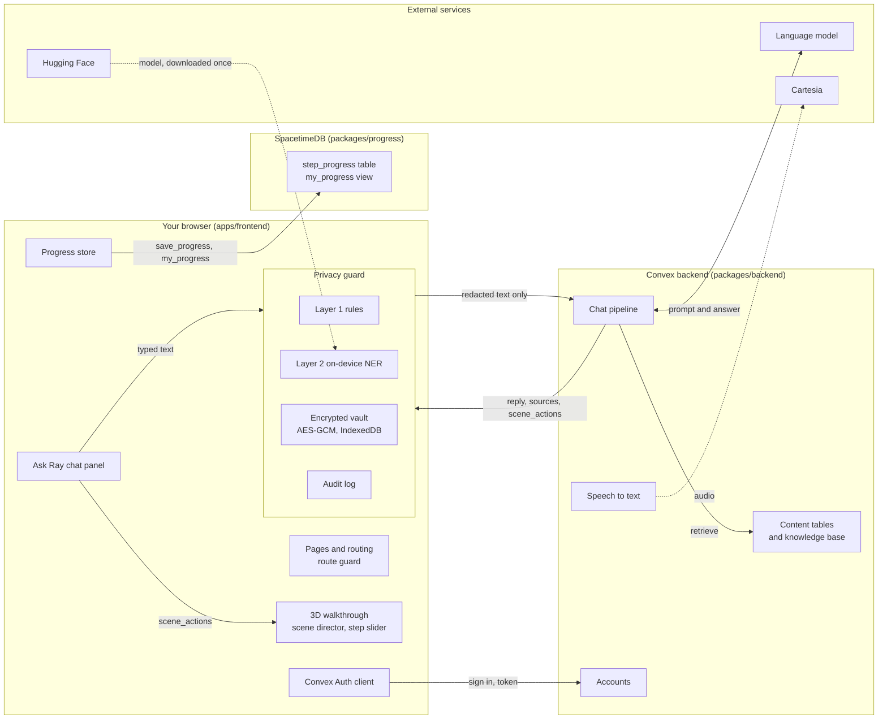

# System architecture

asX-ray (Simple Surgeries) lets a patient watch a heart procedure in 3D, step by step, and ask questions in a chat. Personal details are redacted in the browser before anything reaches the cloud.

Status marks used below: **Works** = built and checked, **Setup** = built but needs setup or a check, **Not built** = planned only.

## Diagram

GitHub renders this diagram. Every box inside "Your browser" runs on the person's device.

Dotted arrows are optional or switched off. The speech path is built but the mic is hidden while the privacy guard is on.

## Components

| Component | Where | What it does | Status |
|---|---|---|---|
| Pages and routing | `apps/frontend/src` | `/`, `/login`, `/signup`, `/walkthrough`, `/walkthroughs-list`. A route guard sends signed-out visitors to `/login`. | Works |
| 3D walkthrough | `apps/frontend/src/walkthrough` | three.js scene driven by per-step scene state (JSON), not video. Scene director, part picker, step slider with 5 TAVR steps. | Works |
| Ask Ray chat panel | `apps/frontend/src/walkthrough/chat` | Typed questions, follow-ups, applies `scene_actions` to the 3D view. | Works |
| Privacy guard | `apps/frontend/src/walkthrough/privacy` | Rules plus an on-device model replace personal details with placeholders. Real values stay in an encrypted vault. A final scan blocks the send if anything personal remains. | Setup (check in a browser) |
| Convex Auth client | `apps/frontend/src/auth` | Login and sign-up pages, login state, route guard. | Setup (check in a browser) |
| Progress store | `apps/frontend/src/progress` | Saves the current step and shows the "Your progress" card. | Setup (needs a published database) |
| Chat pipeline | `packages/backend/convex/chat*.ts` | Scope gate and emergency reply, source retrieval, model call, advice filter, number grounding, then keeps only `scene_actions` that exist in the database. | Setup (production keys missing) |
| Content tables | `packages/backend/convex` | structures, instruments, conditions, procedures, steps, annotations, and the sourced knowledge base. | Setup (seed production) |
| Speech to text | `packages/backend/convex/speech.ts` | Upload, transcribe with Cartesia, then delete the audio. | Setup (needs the Cartesia key) |
| Accounts | `packages/backend/convex/auth.ts` | Convex Auth with username and password. `users.viewer` never returns the email. | Works (tested on a dev deployment) |
| Viewing progress | `packages/progress` | Private `step_progress` table, `my_progress` view returns only the caller's rows. | Setup (tested locally, not published) |
| Shared contract | `packages/shared` | zod schemas for `ChatResponse` and `scene_actions`, with fixtures. | Works |
| Language model | external | Groq or Gemini in the cloud, or Llama through Ollama locally. | Setup (needs a key) |
| Not built | | Microsoft Entra login (Convex Auth replaced it), Presidio second opinion, Azure OpenAI, Azure Key Vault. | Not built |

## What happens when someone asks a question

1. The person types. The guard underlines personal details as they type.
2. On send, rules and the on-device model replace each detail with a placeholder such as `[PERSON_1]`. The real values stay in the encrypted vault.
3. A last rules scan runs on the exact outgoing text. If anything still looks personal, the send is blocked.
4. Only the redacted text goes to `chat.ask`, with the current step and the selected part.
5. The backend checks scope, finds sources, asks the model, filters advice-like wording, checks numbers against sources, and drops any scene action that is not in the database.
6. The reply returns as a message, sources and `scene_actions`. Placeholders in the message are filled in on the device.
7. The scene director moves the camera, highlights parts or changes the step.

## Where data lives

| Data | Where it lives |
|---|---|
| Name, date of birth, SSN typed in chat | Device only, in the encrypted vault. The cloud sees placeholders. |
| Account details | Convex: username, first and last name, contact email, password hash. |
| Viewing progress | SpacetimeDB: step numbers under an anonymous identity. |
| Chat text | Convex, redacted, for the open conversation only. It is deleted when the page closes. |
| Voice audio | Convex storage until transcribed, then deleted. Hidden while the guard is on. |

Names and emails stored in Convex must never reach the chatbot or any model.

## Environments

| Where | What works | Status |
|---|---|---|
| Local, no setup | 3D walkthrough, demo chat answers, privacy guard. | Works |
| Local with the committed default | `pnpm dev:frontend` reads `apps/frontend/.env.development`, so login and sign-up use the shared dev deployment. `.env.local` overrides it. | Works |
| Convex dev deployment | Sign-up, login and the route guard, checked from the command line. The real chatbot needs a model key. | Setup (browser check pending) |
| Convex production | No environment variables and no auth keys yet. Nothing is seeded. | Setup |
| Hosted website | No host chosen. It needs `VITE_CONVEX_URL`, `VITE_CHAT_BACKEND`, and a single-page-app fallback rule so refreshing `/login` does not return a 404. | Setup |

## Open items

- **Production Convex:** deploy, set the auth keys, set the model keys, seed the content. Steps are in [auth.md](auth.md).
- **Hosting:** add the single-page-app fallback rule and the build variables.
- **Voice:** the speech key is unset. Audio is transcribed on the server, so it cannot be redacted first, and the mic stays hidden while the guard is on.
- **Two Convex clients:** chat and sign-in each create their own, so the chat does not carry the sign-in token.
- **Not behind login:** `/devices-lab`.
- **Unchecked in a real browser:** the on-device model, the encrypted vault, the login pages and the progress card.
- **SpacetimeDB:** the module is tested locally but not published to Maincloud.

## Related docs

[auth.md](auth.md), [privacy-layer.md](privacy-layer.md), [chatbot.md](chatbot.md), [contracts.md](contracts.md), [product-roadmap.md](product-roadmap.md), and `packages/progress/README.md`.
